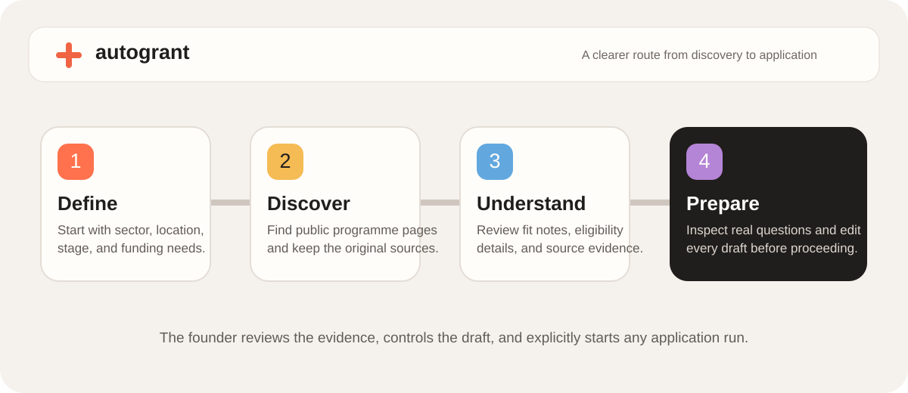

# AutoGrant

AutoGrant helps founders turn a startup profile into a source-linked funding workflow: discover public opportunities, review the evidence and eligibility context, then prepare an editable application draft. It combines a Next.js frontend with a FastAPI service for discovery, assessment, form inspection, drafting, monitoring, and application-run tracking.



## What it does

- **Discover:** Searches public funding pages by sector and location, retains source links, and caches successful searches for 10 minutes per service process.
- **Understand:** Separates strategic fit from provider eligibility. Every recommendation keeps the original source available for founder review.
- **Prepare:** Inspects an application form read-only, saves canonical questions and constraints, and drafts answers that founders can edit.
- **Track:** Stores owner-scoped workspace records, versioned drafts, inspection runs, application runs, and public-page funding watches in Firestore.

The founder stays in control. Eligibility must be confirmed with the programme provider, every draft is editable, and an application run can start only after explicit confirmation. A run is marked submitted only when the provider returns confirmation evidence; uncertain outcomes remain `unknown`.

## Product routes

| Route | Purpose |
| --- | --- |
| `/` | Product overview and interactive Discover → Understand → Prepare walkthrough. |
| `/signup`, `/login` | Firebase email/password registration and sign-in. |
| `/dashboard` | Founder profile, grant workspace, source review, drafting, watches, and run status. |
| `/thank-you` | Post-action confirmation. |

Unknown routes render a branded 404 page. Grant tools require a signed-in user with a verified email address.

## Local setup

Requirements: Node.js 22+, Python 3.12, and Firebase, TinyFish, and Gemini credentials for the full stack.

```sh
npm ci
python3.12 -m venv python-service/.venv
python-service/.venv/bin/pip install -r python-service/requirements.txt
```

Create both environment files. They serve different processes:

1. Copy `.env.example` to `.env.local`. Add the Firebase web values, `NEXT_PUBLIC_SITE_URL`, and `FIREBASE_SERVICE_ACCOUNT_JSON` for the Next.js server-side proxy. In local development, `PYTHON_SERVICE_URL` defaults to `http://localhost:8000`.
2. Copy `python-service/.env.example` to `python-service/.env`. Add `FIREBASE_SERVICE_ACCOUNT_JSON`, `TINYFISH_API_KEY`, and `GEMINI_API_KEY`; set `ALLOWED_ORIGINS` to the frontend origin. Add `PUBLIC_WEBHOOK_BASE_URL` when running public funding watches.

`FIREBASE_SERVICE_ACCOUNT_JSON` must be valid one-line JSON. Keep it, TinyFish keys, Gemini keys, and any deployment tokens out of source control. `.env.local` does not configure the standalone Python service; it needs its own `python-service/.env`.

Start the two services in separate terminals:

```sh
cd python-service && .venv/bin/uvicorn app.main:app --host 127.0.0.1 --port 8000
```

```sh
npm run dev
```

Open `http://localhost:3000`. The API exposes `/health` for process health and `/ready` for a credential-safe readiness summary.

## Application safeguards

- All grant requests carry a Firebase ID token; both the Next.js proxy and FastAPI require a verified email. Consequential run and status requests also verify token revocation.
- Form inspection is read-only. Login walls and incomplete forms are recorded as incomplete rather than treated as ready to submit.
- A draft must match the latest inspected questions and source version. Required uploads, unsupported fields, missing answers, and violated word/character limits block an automated run.
- Provider credentials, passwords, and MFA codes are never collected. Vault sign-in is disabled.
- A run reservation is recorded before the one provider request. Repeated clicks reuse that record, and ambiguous starts are never retried automatically.

For scheduled funding watches, run the worker separately:

```sh
cd python-service && .venv/bin/python -m app.worker --loop
```

On serverless or scheduled infrastructure, invoke `python -m app.worker` at least once per minute from a durable worker environment.

## Docker

With both environment files configured, build and start the local stack:

```sh
docker compose --env-file .env.local up --build
```

The frontend is exposed at `http://localhost:3000`; the API remains on the private Compose network. For production, use `docker-compose.production.yml` with `WEB_IMAGE`, `API_IMAGE`, `.env.production`, and `python-service/.env` supplied by the deployment environment.

## Verification

```sh
npm run lint
npm test
npm run build
cd python-service && .venv/bin/python -m unittest discover -s tests -v
```

The automated service tests mock external providers. Before exercising a real application run, use a controlled Firebase account and a provider-approved test application—never a live grant submission.

## Delivery

[`.github/workflows/ci.yml`](.github/workflows/ci.yml) runs frontend linting, behavior tests, a production build, and Python service tests for pull requests and pushes to `main`. When those checks pass on `main` or a version tag, CI publishes frontend and API images to GHCR.

For deployment, put the six `NEXT_PUBLIC_FIREBASE_*` values and `NEXT_PUBLIC_SITE_URL` in GitHub Actions variables. Keep `FIREBASE_SERVICE_ACCOUNT_JSON`, `TINYFISH_API_KEY`, and `GEMINI_API_KEY` in the deployment platform’s secret manager.
